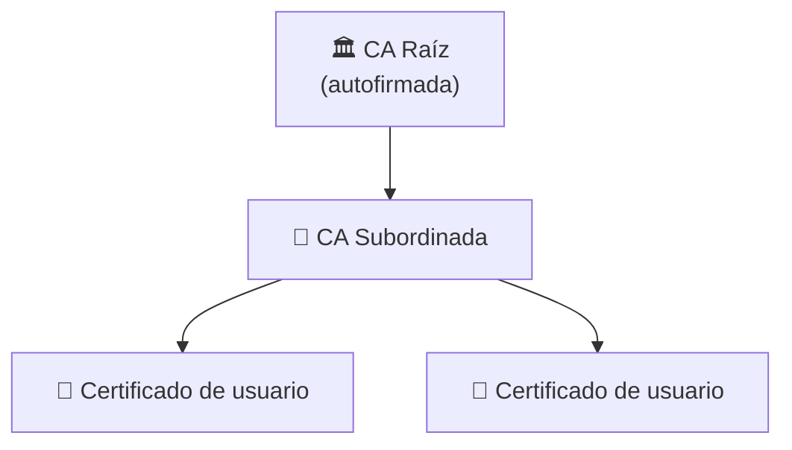

<div align="center">

# 🔒 Sistema de Mensajería Segura

**PKI jerárquica · Cifrado híbrido · Firma digital**

Plataforma de mensajería segura en Python con autenticación robusta, certificados X.509 y garantías de confidencialidad, integridad y no repudio.


[📖 Descripción](#-descripción) · [🚀 Características](#-características-principales) · [🛠️ Instalación](#️-requisitos-e-instalación) · [📂 Estructura](#-estructura-del-proyecto) · [💻 Uso](#-uso)

</div>

---

## 📖 Descripción

Este proyecto implementa una plataforma de mensajería segura desarrollada en **Python**. Combina:

- 🔑 **Autenticación robusta** de usuarios.
- 🏛️ Una **Infraestructura de Clave Pública (PKI)** jerárquica.
- 🔐 **Cifrado híbrido** para garantizar la confidencialidad.
- ✍️ **Firmas digitales** para asegurar la integridad y el no repudio de los mensajes.

## 🎯 Garantías de seguridad

| Propiedad | Cómo se consigue |
|---|---|
| 🕵️ **Confidencialidad** | Cifrado híbrido (RSA + criptografía simétrica): solo el destinatario legítimo puede leer el mensaje |
| 🧾 **Integridad** | Firma digital: cualquier manipulación del mensaje se detecta |
| 🪪 **Autenticidad y no repudio** | La firma identifica al emisor, validada con su certificado X.509 |
| 🛡️ **Contraseñas protegidas** | Hash con Argon2 y salado, con validación estricta de credenciales |
| ⛓️ **Confianza verificable** | Validación de la cadena completa de certificados hasta la CA Raíz |

## 🚀 Características principales

### 🔑 Autenticación segura
Hash de contraseñas mediante el algoritmo **Argon2** con salado y validación estricta de credenciales.

### 🏛️ Infraestructura de Clave Pública (PKI)
- Generación de una **Autoridad Certificadora Raíz** (CA Raíz) autofirmada.
- Gestión de **Autoridades Certificadoras Subordinadas**.
- Emisión, almacenamiento y validación de la **cadena completa de certificados X.509** para los usuarios.



### 🔐 Cifrado híbrido de mensajes
Combinación de criptografía **asimétrica (RSA)** y **simétrica** para garantizar que solo el destinatario legítimo pueda leer el contenido.

### ✍️ Firma digital e integridad
Firmado digital de mensajes para verificar la identidad del emisor y descartar manipulaciones.

### 🧪 Suite de pruebas
Pruebas unitarias integradas (`tests.py`) que verifican la integridad de las cadenas de certificados, las firmas digitales y la gestión de claves.

## 🛠️ Requisitos e instalación

### Prerrequisitos

- 🐍 **Python 3.8+**
- Las bibliotecas criptográficas indicadas abajo.

### Instalación de dependencias

```bash
pip install cryptography argon2-cffi
```

## 📂 Estructura del proyecto

```text
.
├── autenticacion.py                 # Registros, login y hashing con Argon2
├── certificado.py                   # Carga y lectura de certificados X.509
├── crear_usuarios.py                # Estructura de directorios y gestión de claves por usuario
├── encriptado_hibrido.py            # Cifrado y descifrado de mensajes
├── firmas.py                        # Firma digital y verificación criptográfica
├── gestor_certificados_usuarios.py  # Emisión y consulta de certificados de usuarios
├── inicializar_pki.py               # Creación de la CA Raíz y las CAs Subordinadas
├── verificador_cadenas.py           # Validación de la cadena de confianza
├── main.py                          # Interfaz de consola e interactividad
└── tests.py                         # Pruebas unitarias
```

| Módulo | Responsabilidad |
|---|---|
| 🔑 `autenticacion.py` | Registro, login y hashing con Argon2 |
| 📜 `certificado.py` | Utilidades de certificados X.509 |
| 👥 `crear_usuarios.py` | Directorios y claves por usuario |
| 🔐 `encriptado_hibrido.py` | Cifrado y descifrado de mensajes |
| ✍️ `firmas.py` | Firma y verificación |
| 🗂️ `gestor_certificados_usuarios.py` | Emisión y consulta de certificados |
| 🏛️ `inicializar_pki.py` | CA Raíz y CAs Subordinadas |
| ⛓️ `verificador_cadenas.py` | Cadena de confianza |
| 🖥️ `main.py` | Menú interactivo |
| 🧪 `tests.py` | Pruebas unitarias |

## 💻 Uso

### 1️⃣ Ejecutar el sistema

Para iniciar el menú interactivo del sistema de mensajería:

```bash
python main.py
```

> 💡 Al ejecutarlo por primera vez, el sistema inicializa automáticamente la jerarquía de la PKI si no existe.

### 2️⃣ Ejecutar la suite de pruebas

Para comprobar el funcionamiento de las funciones criptográficas y la validación de certificados:

```bash
python -m unittest tests.py
```

## 👥 Colaboradores

- **María Arias**

---

<div align="center">

🔒 Proyecto académico de criptografía aplicada · Python

</div>
